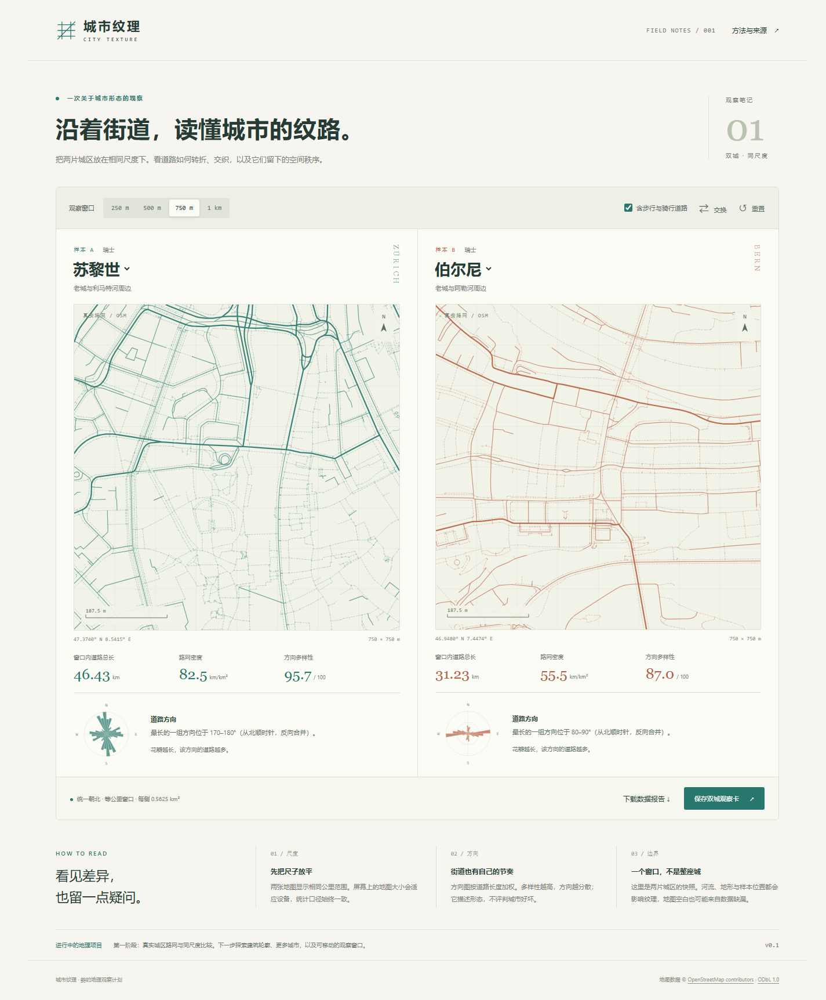
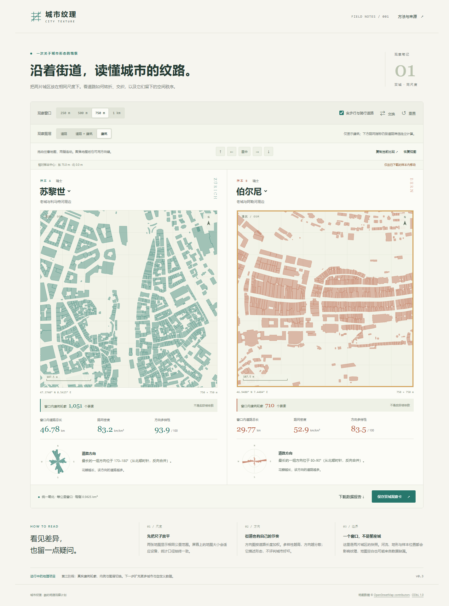
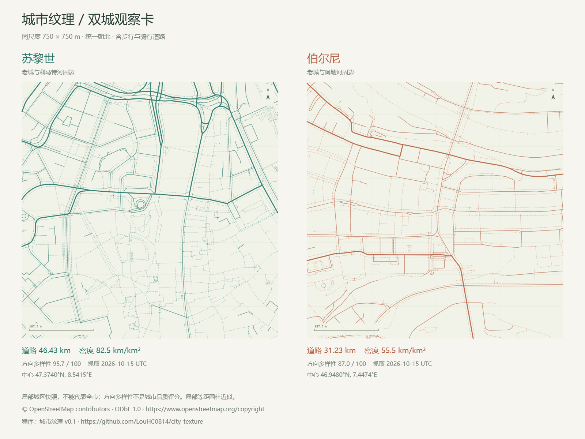

# 城市纹理 · City Texture

**在同一公里尺度下，观察两座城市的道路纹理。**

一个正在开发的人文地理交互项目。当前 v0.3 使用苏黎世和伯尔尼的真实 OpenStreetMap 道路与建筑轮廓，实现双城对照、连动探索、几何分析和观察卡导出。程序为独立实现的原生 HTML / CSS / JavaScript，没有运行时第三方依赖，也不需要账号、密钥或地图瓦片服务。



## 直接下载使用（推荐）

打开 **[最新 Release 下载页](https://github.com/LouHC0814/city-texture/releases/latest)**，在页面下方 **Assets** 下载 **city-texture-v0.3.0-offline.zip**。完整解压后，双击 **打开城市纹理.html**。

也可下载 **city-texture-v0.3.0.html**，用 Chrome / Edge 打开。无需安装 Node.js、Python 或其他依赖，断网可用。详细步骤见 [中文使用说明](docs/使用说明.md)。GitHub 自动提供的 Source code 是开发用源码包。

## 当前做到哪里

- 两个真实城区样本：苏黎世老城周边、伯尔尼老城周边，**均不代表整座城市**。
- 250 m、500 m、750 m、1 km 四种等公里观察窗口，地图统一朝北。
- 道路筛选、城市选择、交换与重置；比较状态保存在 URL 片段中。
- 拖动任一地图，两侧保持相同公里位移；支持鼠标、手机触摸、方向按钮和键盘方向键。Home 或“居中”回到样本中心。
- 依据两份下载框约束移动范围，抵达边界会提示；放大窗口后重新限制位置，避免观察未下载区域。
- 复制和恢复视图，记录城市、尺度、筛选与毫米精度的位置。自动复制失败时提供手动复制框；兼容 v0.1 的旧视图参数。
- 道路总长、路网密度、长度加权的道路方向图与方向多样性。
- 道路、道路＋建筑、建筑三种图层；建筑内院保留为空白，支持闭合 way 与可拼接的 multipolygon。
- 随观察窗口变化的建筑轮廓要素数：**不是独立楼栋或住房数**，不推算建筑覆盖率。
- 导出 1600 × 1200 PNG 双城观察卡，以及带坐标、统计口径和来源的 JSON 报告。
- 桌面双列、手机纵向布局；方法说明支持键盘打开与关闭。
- **完全离线可用**，附原始数据归档、校验值和离线重建脚本。

## 如何体验

除了上面的 Release 成品，也可以下载仓库源码 ZIP 并完整解压，用 Chrome 或 Edge 打开 `dist/index.html`。不需要安装依赖。

已有 Node.js 22 或更新版本时，也可以运行：

```text
npm start
```

打开终端提示的 `http://127.0.0.1:4173`。开发服务器只监听本机。此版本未部署在线站点。

生成可以单独传递的 HTML：

```text
npm run build:standalone
```

输出为 `.runtime/城市纹理-第三阶段预览.html`。该文件包含全部道路、建筑样本与脚本，不需要服务器。

## 如何移动和保存观察位置

拖动任意一张地图，两侧会连动平移；两座城市采用相对各自样本中心的相同东/北公里位移，不是跳到相同经纬度。点“居中”只重置位置；点“重置”恢复城市、尺度、筛选和位置的默认值。

键盘操作：Tab 聚焦地图后，用方向键移动，每次移动窗口宽度的 10%；Home 回到样本中心。手机可以直接拖动地图，从地图之外的位置滚动页面。

点“复制当前比较”得到一段以 `#v=3` 开头的视图参数，包含当前图层。另一位使用者需要拥有支持相同城市的预览文件，再点“恢复视图”粘贴。**这不是公开网页链接，不需要复制本机文件路径。** 在线地址里的同格式片段也可粘贴，但应用只解析参数，不会打开该地址。旧 `#v=1` 参数恢复到样本中心，`#v=2` 保留平移位置；二者均保持原来的仅道路图层。

## 建筑轮廓怎么读



苏黎世样本收录 1,573 个建筑轮廓要素，伯尔尼收录 1,359 个；这是下载范围内的总数，界面显示的是当前窗口中与其有正面积交集的数量。一个多边形关系可能包含多片轮廓，边界上的轮廓只计一次；全部落在内院里的观察窗口不会误计建筑。

图层切换改变画面，不改变道路筛选口径。仅建筑模式下仍显示独立的路网指标，界面和导出会标注。建筑数据不含高度，不是三维楼体，也不等于住房或人口分布。详见 [建筑数据说明](docs/建筑数据说明.md)。

## 先看一张观察卡



地图中的虚线表示已收录的步行或骑行道路，其他道路按类别使用不同线宽。步行道开关同时影响地图和统计。密度可能受独立人行道、服务道路、分隔车道与 OSM 收录完整度影响，不宜直接拿来评价城市。

## 计算方法

道路坐标以城区中心投影到局部公里平面；按观察窗口裁剪线段，再以无向 OSM 节点对去重。总长与面积给出密度。方向折叠到 0–180° 后按 10° 分箱，以线段长度加权计算 Shannon 熵，并归一化到 0–100。

**方向多样性不是城市质量评分，也不能单独判断城市是否网格化。** 对分箱边界敏感，不同道路角度可能产生不同数值。详见 [方法与限制](docs/方法与限制.md)。

## 数据来源与可复核性

数据来自 [Swiss Overpass API](https://overpass.osm.ch/)。道路抓取于 2026-10-15 UTC，建筑抓取于 2026-10-16 UTC，两个批次分别保留来源。应用保存原始查询、抓取时间、接口快照标识及 SHA-256；标识 `117749` / `117765` **不是日期**，不将抓取时间宣称为地图数据的更新时间。

- `data/snapshots/`：道路与建筑各两个原始 Overpass JSON 的 gzip 归档。
- [道路来源清单](data/来源清单.json)、[建筑来源清单](data/建筑来源清单.json)：查询、时间和原始文件校验值。
- `dist/data/`：由原始数据转换出的浏览器样本。
- [数据许可](数据许可.md)：OpenStreetMap contributors / ODbL 1.0。

有 Python 3.10 或更新版本时，用自己的解释器运行：

```text
<Python解释器绝对路径> scripts/获取城市数据.py --offline
<Python解释器绝对路径> scripts/获取建筑数据.py --offline
```

脚本会校验归档并离线重建样本。仅使用 Python 标准库。去掉 `--offline` 时优先使用本地缓存；`--force` 才会重新请求公开接口。刷新后应同步归档与来源清单，避免混用不同版本的数据。

## 验证

```text
npm test
npm run test:browser
<Python解释器绝对路径> -m unittest discover -s tests -p test_buildings.py
```

单元和数据检查覆盖裁剪、边界接触、重复边、分隔车道、折线方向、长度权重、筛选、投影、移动窗口、共同边界、平移报告、视图参数，以及建筑内院、凹多边形、边界相切、关系成员乱序拼接与损坏输入。

浏览器检查使用 Node 内置模块与已安装的 Chrome / Edge，实际执行鼠标、触摸和键盘事件，检查三种图层、真实内院像素、下载 PNG / JSON、移动端布局，并阻断网络验证单文件。自动复制的成功和拒绝路径在隔离的浏览器接口中验证，不读取或修改用户的系统剪贴板。可用环境变量 `CHROME_PATH` 指定浏览器。测试只启动隐藏浏览器和本机服务，结束时关闭。本机已通过 **32 项 JavaScript 检查、9 项 Python 检查和浏览器验证**；GitHub Actions 运行前两类检查、四份样本的离线重建校验及单文件打包，不宣称 CI 执行了浏览器检查。

## 原创与参考

界面、同尺度双城交互、Canvas 绘制、几何计算、报告与导出独立实现。参考了公开的道路展示与城市形态分析方法，未复制参考项目的源码、图片或地图预设。使用成熟方法不代表发明了这些算法。

详见 [参考与致谢](docs/参考与致谢.md)。程序代码采用 MIT；地图数据单独采用 ODbL 1.0。

## 后续计划

- 增加南京、巴黎等更多地区的真实样本，解决全球公共接口的不稳定问题。
- 增加更多地区的建筑样本与可复核的街区分析。
- 增加自定义数据导入和更大范围的样本。
- 研究经过口径校验的连通性指标。当前版本没有路口密度、人口、收入或宜居性推断。

更多城市、三维建筑和自定义数据导入尚未实现。版本进展见 [阶段记录](docs/阶段记录.md)。
