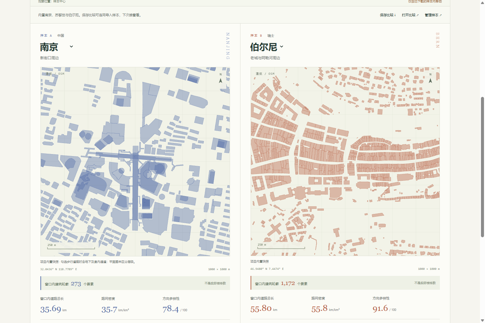
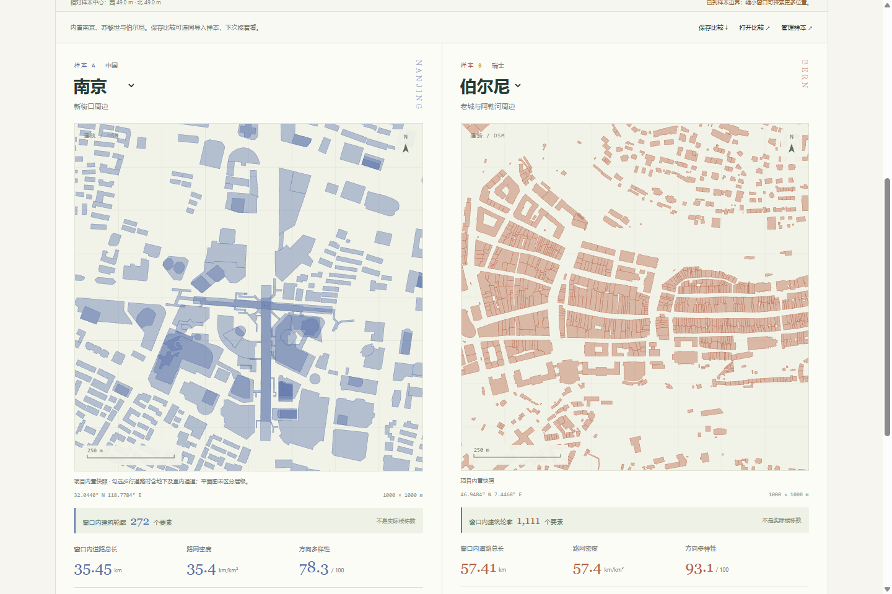
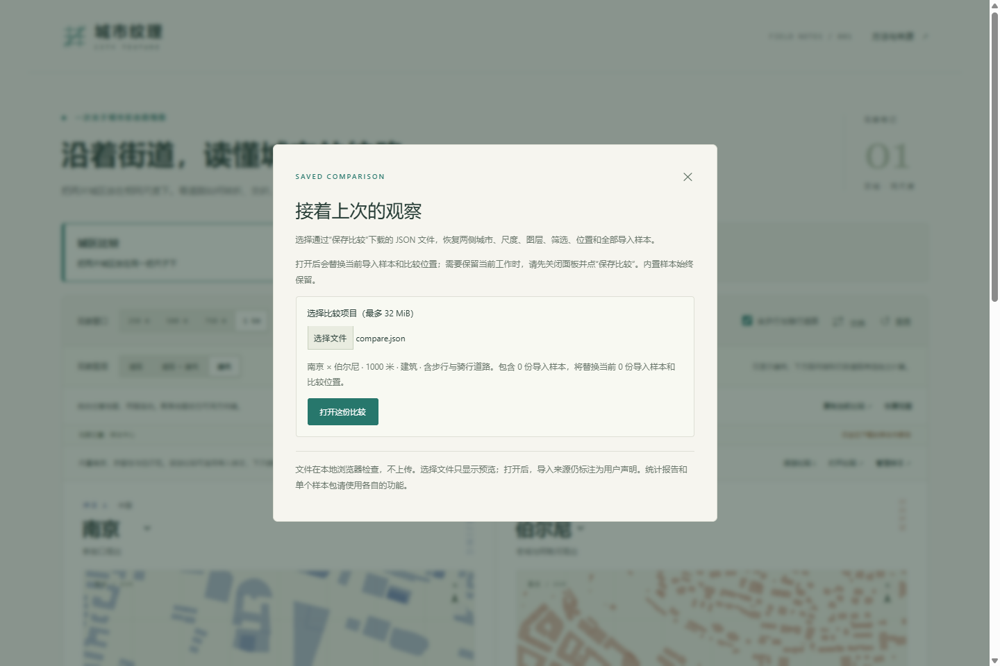
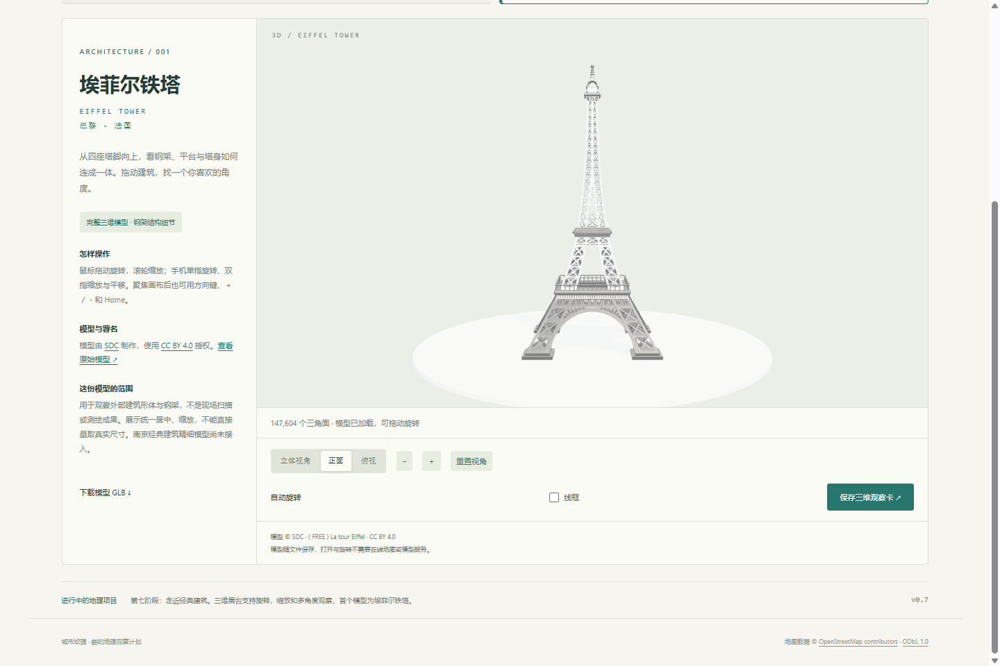
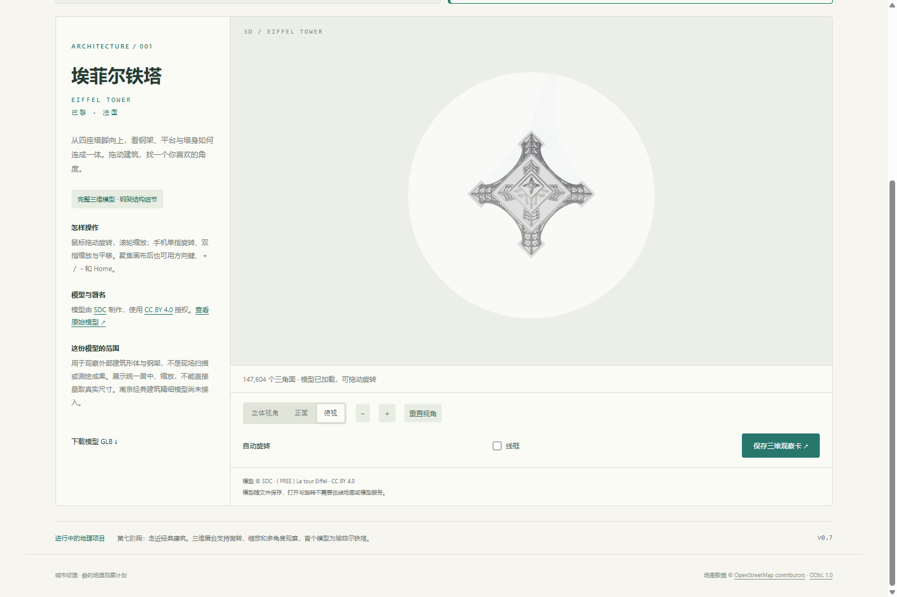

# 城市纹理 · 新手体验指南（v0.7.0）

这份指南按 v0.7.0 正式版的实际按钮写成，核对于 2026-10-17。下载完成后，解压与日常使用不需要联网；首次获取发行包需要联网。全程不用装任何东西。

## 一、下载与打开（2 分钟）

1. 打开 [v0.7.0 发行版页面](https://github.com/LouHC0814/city-texture/releases/tag/v0.7.0)。本指南对应这个版本；从 [最新发行版](https://github.com/LouHC0814/city-texture/releases/latest) 进也可以，但新版文件名可能与本文不一致。
2. 往下滚到 **Assets**，点 **city-texture-v0.7.0-offline.zip**（约 2.7 MB）。
3. **完整解压**（右键 → 全部解压缩），不要直接在未解压的压缩包预览窗口里双击。解压后得到文件夹 **城市纹理-v0.7.0**。
4. 进文件夹，双击 **打开城市纹理.html**。

下载页上注意：Assets 里带 `.html` 和 `.zip` 的是给你用的；**Source code** 是给开发者看源码的，新手不用碰。也可只下载 `city-texture-v0.7.0.html` 单文件，用 Chrome / Edge 打开。

## 二、五分钟体验路线

**第 1 步｜选城区。** 打开后默认是苏黎世 ↔ 伯尔尼。在左侧"样本 A"下拉里选 **南京**（新街口周边），右侧保留伯尔尼即可比较。

**第 2 步｜定尺度。** 顶部"观察窗口"点 **1 km**。两侧地图始终是同一公里数，"同尺度"是这个工具的前提——换尺度时两侧一起变。

**第 3 步｜切图层、拖地图。** "观察图层"点 **道路 + 建筑** 或 **建筑**。然后按住任一张地图拖动，两侧会同步平移；下方"观察位置"会显示"相对样本中心：西 xx m · 北 xx m"。想回原位点 **居中**。键盘：Tab 聚焦地图后用方向键，Home 回中心。

**第 4 步｜导出观察卡。** 右下角 **保存双城观察卡**，得到一张 1600 × 1200 的 PNG，可直接贴进作业。需要数字就点 **下载数据报告**，是一份带来源说明的 JSON。

**第 5 步｜保存并重开比较。** 点 **保存比较** 得到 `城市纹理-比较项目.json`；下次打开程序后点 **打开比较** → 选这个文件 → 看清预览（会写明"南京 × 伯尔尼 · 1000 米 · 建筑"）→ 点 **打开这份比较**，位置和图层一次性恢复。

**第 6 步｜看三维建筑。** 点顶部 **经典建筑 3D**，等状态栏出现"147,604 个三角面 · 模型已加载"。拖动旋转、滚轮缩放；**立体视角 / 正面 / 俯视** 一键换角度，**＋ / −** 调远近，**重置视角** 回默认，还能开 **自动旋转**、勾 **线框** 看网格，或 **保存三维观察卡**。

点 **俯视** 换成自上而下的构图，看四个塔脚的相对分布、塔身层次与平台轮廓。**展台只有独立模型和展示底座，没有真实广场和城市环境**，别在这里找街道或轴线。

## 三、电脑与手机

电脑：鼠标左键拖=旋转，滚轮=缩放，右键拖=平移；Tab 聚焦画布后方向键也能转。

手机：单指在画布内拖=旋转，双指捏合=缩放，双指同向移动=平移；画布外滑动=滚动页面。**但手机能不能直接打开本地 HTML，取决于文件管理器和浏览器，不是所有手机都行**；三维展台还需要浏览器支持 WebGL 2，较旧机型可能加载失败，程序会给出重试入口，城区比较仍然可用。

## 四、当前范围（别误会）

- 只收录**局部城区**：南京是"新街口周边"，苏黎世、伯尔尼是"老城周边"，都**不代表整座城市**。
- 界面上的"窗口内建筑轮廓 xx 个要素"是 OSM 轮廓要素数，**不是实际楼栋数，也不是住房数**。
- 城区比较里的建筑是**二维轮廓**；三维展台里的是**一份独立的埃菲尔铁塔模型**，两者不是同一套数据，也不能互相换算。
- **保存比较不含三维相机**：项目文件恢复的是城区比较，三维看的角度不会存下来。南京精细模型、多模型切换、室内漫游在 v0.7.0 都还没有。

## 五、卡住了怎么办

- **双击打开是代码 / 一片空白**：多半是没解压，或在压缩包里直接打开，或被文本编辑器关联了 `.html`。先完整解压，再右键用 Chrome / Edge 打开，地址栏应以 `file:///` 开头。
- **地图空白但界面正常**：先换 750 m 或 500 m 再看，或点 **居中**。仍空白就记录版本、图层、观察位置并截图反馈，别猜原因。
- **三维展台提示加载失败**：点"重新加载三维展台 ↻"；仍失败就换新版 Chrome / Edge，或回到"城区比较"。程序不会自动更新，想用新版要自己再下一次 Release。
